# Crystal Tweaks

[](https://github.com/kerlycanelita/KoHs-Crystal-Tweaks)
[](https://modrinth.com/mod/kohs-crystal-tweaks)
[](https://github.com/kerlycanelita/KoHs-Crystal-Tweaks/issues)
[](https://discord.gg/9t2VxEF7UU)

<p align="center">
  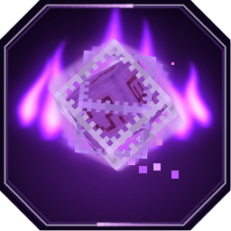
</p>

**Customizable End Crystal visuals, sounds, and responsive previews.**

## About

Crystal Tweaks brings End Crystal visual and sound controls into one animated configuration screen. Version 2.5.0 moves the glow into the crystal: its three layers shine in their own colours inside an aura, with a motion blur as they turn. The screen is built around your crystal: colours on the left, glow on the right, tabs above for sound, the crystal helpers, the advanced tools and KoHs, a red menu of its own for enemy crystals, and Crystal Practice (a practice world against a bot that plays real crystal PvP techniques) below. It supports Minecraft 1.21.11 through 26.3.

## Screenshots

<p align="center">
  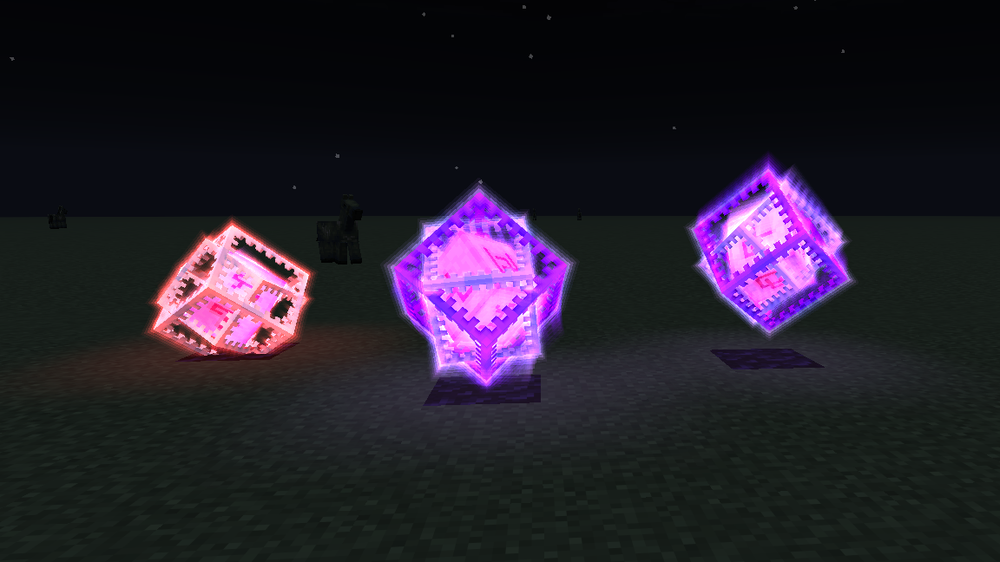
</p>

<p align="center">
  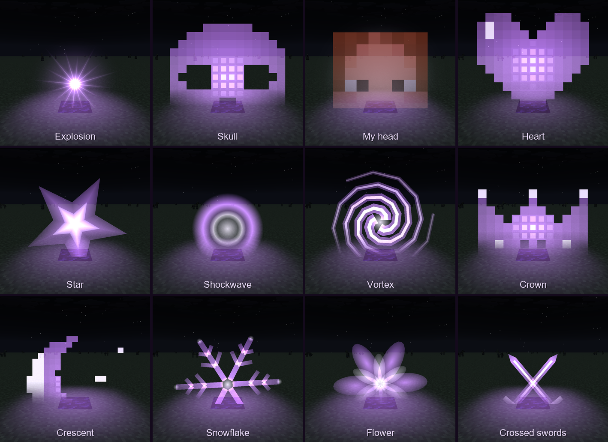
</p>

| Settings | Glow | Flash shapes |
| --- | --- | --- |
| 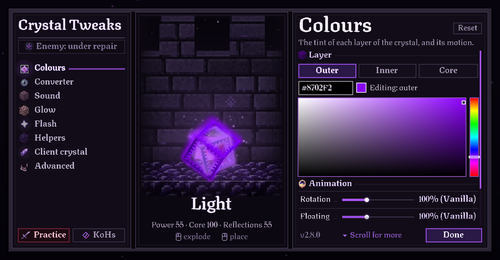 | 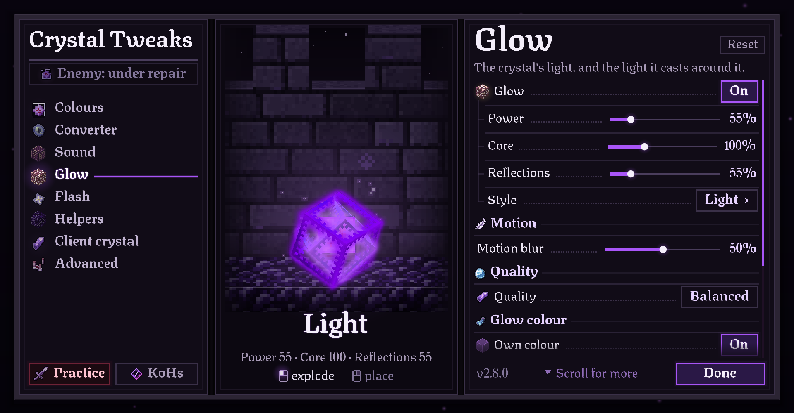 | 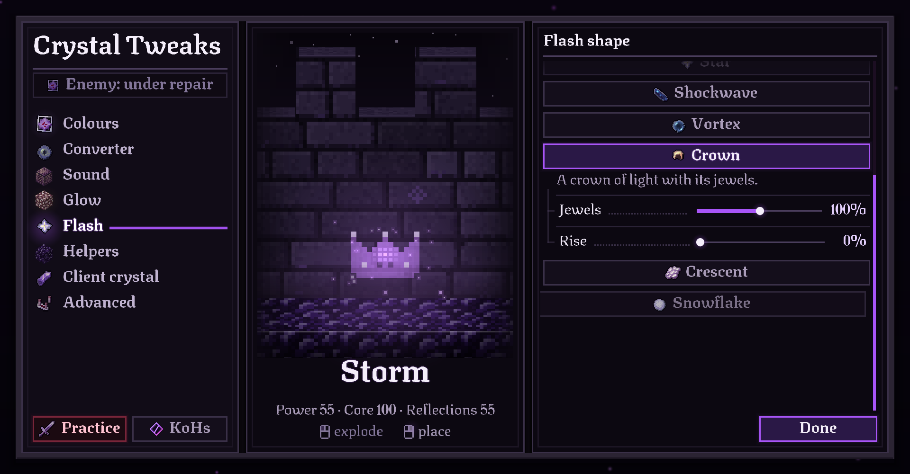 |

| Motion blur | Advanced tab | KoHs |
| --- | --- | --- |
| 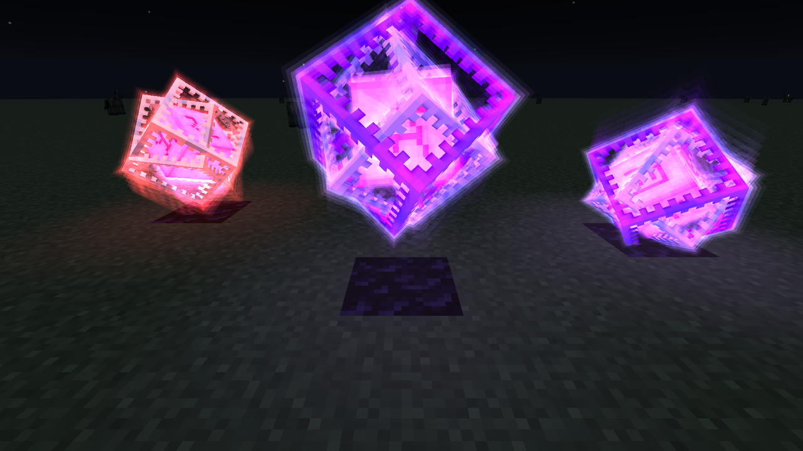 | 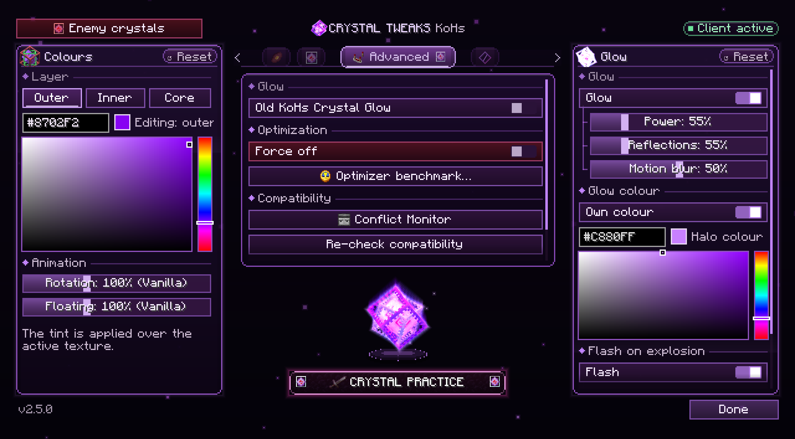 | 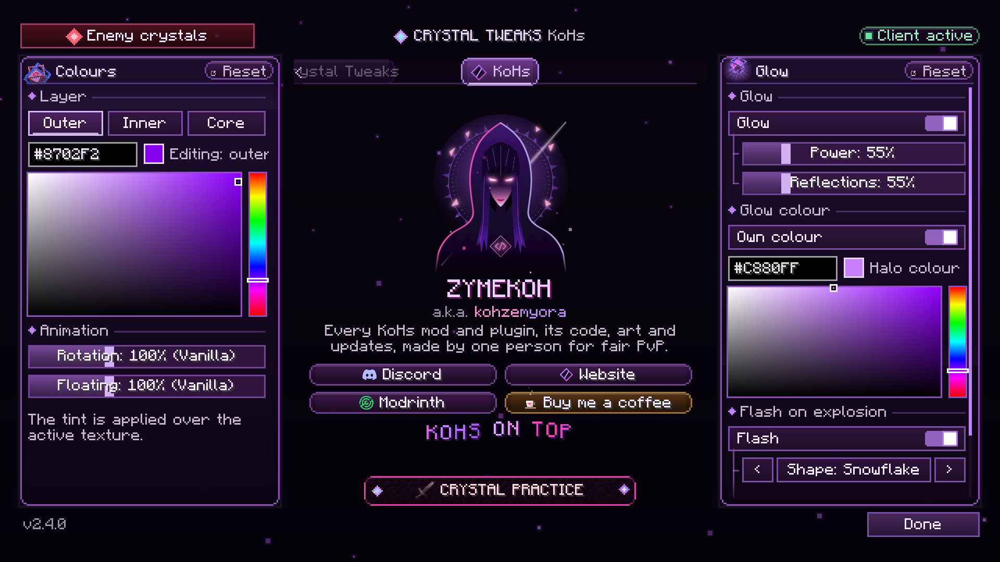 |

| Converter My Crystal | The Converter tab |
| --- | --- |
| 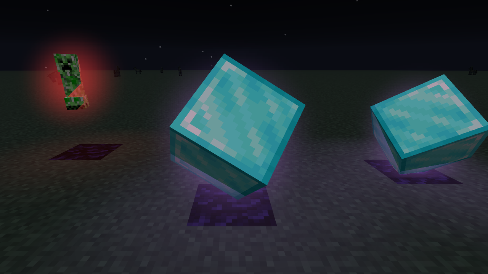 | 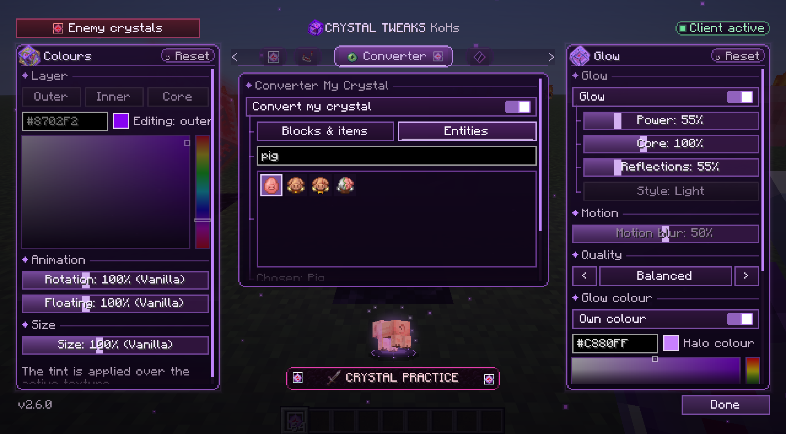 |

| Crystal Practice | Kit editor | What the bot does |
| --- | --- | --- |
| 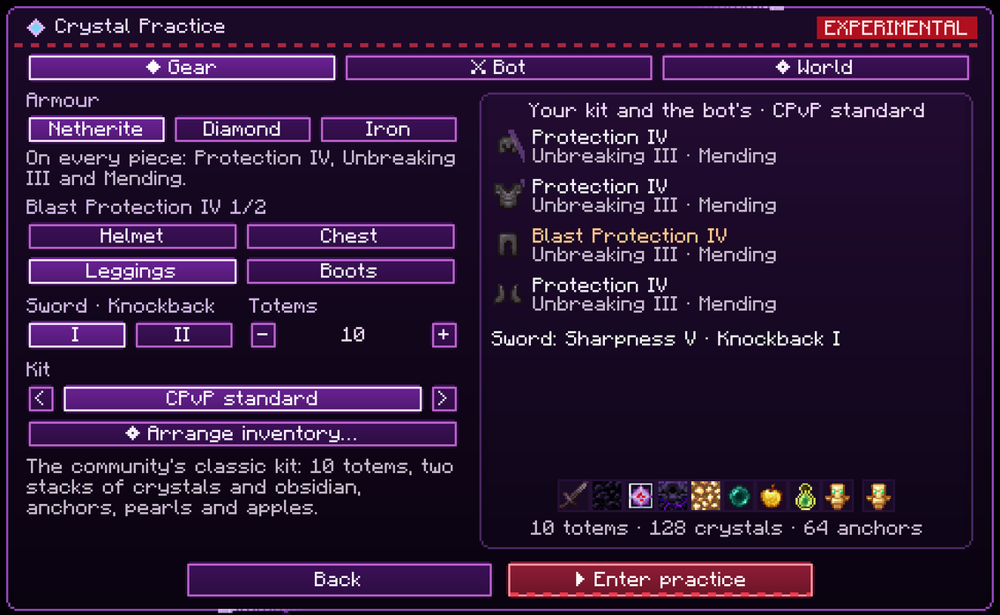 | 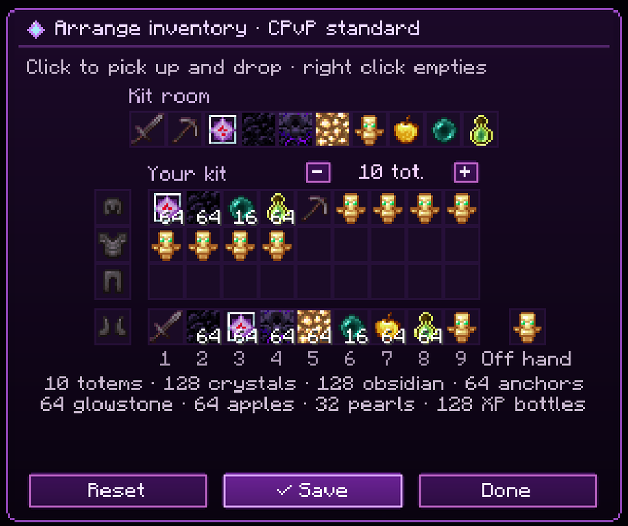 | 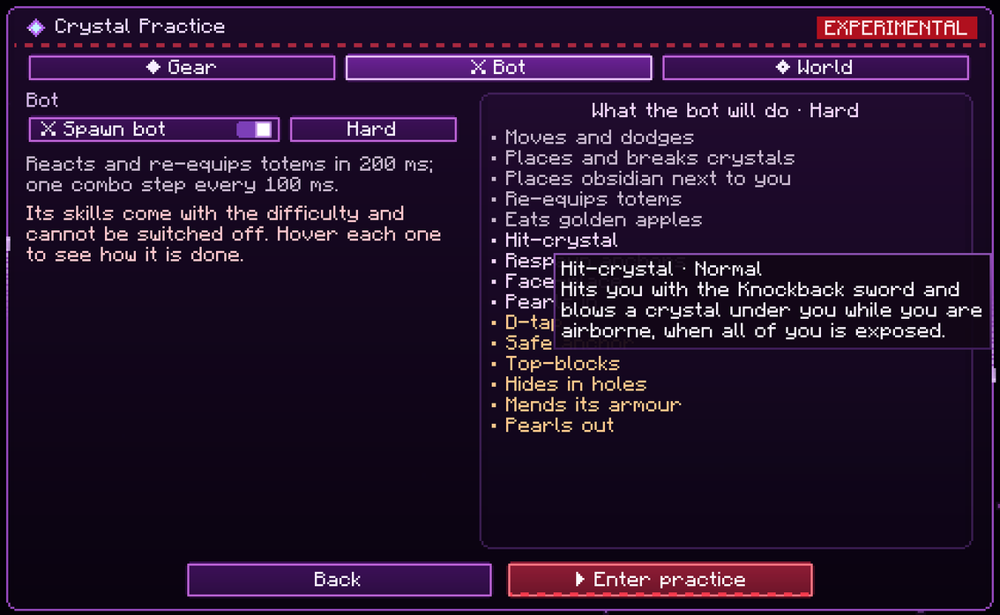 |

<p align="center">
  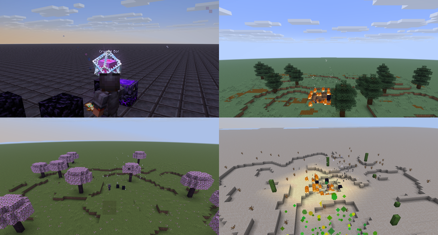
</p>

## What it changes

- Independent colors for the outer layer, inner layer, and crystal core.
- Glow in the crystal's three layers in twelve styles, each with settings of its own: Light and Layers, or Heartbeat, Aurora, Orbit, Flames, Sigil, Storm, Wings, Crown, Vortex and Souls with light of their own round the crystal; `0%`-`300%` power, a core control, colored reflections, its own color, a motion blur that trails the turning layers with or without the glow, and a smooth afterglow trail. Performance, Balanced and Quality modes decide how much it draws. The old halo stays available as Old KoHs Crystal Glow.
- Converter My Crystal (off by default): your crystals, or the enemy's, drawn as any block, item or entity of your game version, picked from a searchable catalogue, still spinning and floating.
- Converter My Obsidian (off by default): your obsidian drawn as another solid, opaque block, so it keeps hiding what it hid. With Its own voice, a converted crystal sounds as what it became as it appears and as it explodes, and converted obsidian sounds as its block.
- Crystal size from `30%` to `200%`, drawing only: the hitbox is the server's.
- Fourteen flash styles for a destroyed crystal, in the glow color and sized from `10%` to `300%`: explosion, skull, your own head as a pale ghost, lightning toward the players you can see, heart, star, shockwave, vortex, crown, crescent, snowflake, flower, gem, and crossed swords.
- Glow that respects walls instead of using an outline drawn through terrain.
- Separate colors, glow, and animation speeds for crystals that were not placed by you (with approximate identification). Under repair for now: its menu is closed and every crystal uses your own profile.
- Rotation and floating speed controls from `0%` to `300%`.
- Custom local explosion sounds with volume and playback-speed controls; they step aside while a converted crystal speaks with its own voice.
- Settings as a book of three pages: the sections by name on the left (Colours, Converter, Sound, Glow, Flash, Helpers, Client crystal, Advanced, with Practice and KoHs under them), your crystal at its real size before a castle wall in the middle, and the open section on the right, with the game's own items as moving icons and option cards that unfold their own settings. Click the crystal to explode it with your flash and sound.
- Don't break obsidian (switchable; formerly Safe Crystal), Obsidian debounce, and a local Conflict Monitor. They follow your own switches whatever else is installed.
- Crystal Practice (experimental): a practice world against a bot that plays real crystal PvP techniques by difficulty (hit-crystal, d-tap, safe and double anchors, butterfly and more, listed with how each works), or a peaceful one that never attacks; your own kit arranged in a kit editor with presets modelled on MCTiers, MCPVP and PVPHQ, a Knockback I or II sword, your choice of totems; and a netherite flat, a hole arena, a natural meadow in eight biomes or a whole normal world. On a server (Minecraft 26.1 and later) it opens in the same window without leaving the server, which stays connected behind it; running two worlds at once can cause lag. Escape brings up the practice panel on the right, and `/rtp`, `/spawn`, `/kit` and `/bot` work in the practice world.
- Spanish localization for Minecraft language codes beginning with `es`; English for every other locale.
- Optional Mod Menu integration.

The Client crystal section, off until you turn it on, hides a crystal you hit from your screen at once and plays its explosion on the hit; it stays in your world, so every packet is Vanilla's. Ghost crystals and Paced placement are there too, both off by default. The client crystal stands down while another crystal optimizer such as Marlow's is installed.

See the [Crystal Tweaks Wiki](docs/WIKI.md) for installation, configuration, preview controls, compatibility notes, and troubleshooting.

## Requirements

- Fabric Loader: each JAR declares the exact minimum it was built against; see
  [`gradle/versions.properties`](gradle/versions.properties).
- The Fabric API version matching your Minecraft installation.
- Java 21 for Minecraft 1.21.11.
- Java 25 for Minecraft 26.1–26.3.
- Mod Menu is optional but recommended for opening the configuration screen.

## Supported Minecraft versions

Crystal Tweaks supports **Minecraft 1.21.11 and later**. The build matrix contains these exact
targets:

```text
1.21.11, 26.1, 26.1.1, 26.1.2, 26.2, and 26.3
```

Each JAR declares one exact Minecraft version. Minecraft 1.21 through 1.21.10 were archived on
26 September 2026: their last release, 2.2.7, stays downloadable on Modrinth, and
[archive/README.md](archive/README.md) lists what was kept and how to rebuild one.

## Compatibility and multiplayer

Do not load Crystal Tweaks together with the retired KoHs Crystal Tweaks mod or another mod that owns the same crystal input, prediction, or interaction paths. Competing mixins can produce inconsistent behavior even when one mod declares a higher mixin priority.

Server rules differ. Review the rules of every multiplayer server and obtain staff approval when required; this project cannot guarantee acceptance by every server or anticheat.

Crystal Tweaks never fabricates, reorders or duplicates a gameplay packet, and never changes reach,
rotation, attack cooldown or click rate. The server stays authoritative over every crystal. The one
setting that changes when a click goes out is Paced placement, off by default: it holds a click on
the crystal you just broke until the server removes it, and never places ahead of the server.

With Client crystal off, as it starts, a crystal you hit disappears and explodes when the server says
so, as in Vanilla; with it on, only your screen changes.

Crystal Practice on a server keeps that server connected behind the practice world: the player stays
there standing still, as with a menu open, and the client keeps answering the server with exactly the
packets a Vanilla client in a menu sends. Nothing it does in the practice world reaches the server.

See [docs/audits/LEGITIMACY_AUDIT.md](docs/audits/LEGITIMACY_AUDIT.md) for the full client/server boundary of every feature,
including the one place where the mod changes which packets are sent: Don't break obsidian (and the optional obsidian debounce), which you can switch off.

## Building

Every supported Minecraft version has its own row in [`gradle/versions.properties`](gradle/versions.properties),
holding the Fabric Loader, Fabric API, Mod Menu and Java release that target is built against. Pick a
target with `-Pmc`:

```powershell
.\gradlew.bat build -Pmc=26.1.2
```

To build the whole matrix, collect the JARs into `versions/` and refresh `CHECKSUMS.sha256`:

```powershell
.\tools\build-all.ps1
```

See [docs/RELEASING.md](docs/RELEASING.md) for the full release process and for how to add a new Minecraft
version.

## Support

- [Read the wiki](docs/WIKI.md)
- [Report a problem](https://github.com/kerlycanelita/KoHs-Crystal-Tweaks/issues/new)
- [Join the Discord server](https://discord.gg/9t2VxEF7UU)
- [Download from Modrinth](https://modrinth.com/mod/kohs-crystal-tweaks)

## Repository layout

| Location | Contents |
| --- | --- |
| `src/` | Shared client sources and the version-specific rendering adapters. |
| `gradle/` | Wrapper and the exact Minecraft dependency matrix. |
| `docs/` | Wiki, release workflow, audits and version notes. |
| `tools/` | Build, artifact, Mixin and appearance checks. |
| `archive/` | Code and matrix rows of the archived 1.21–1.21.10 targets; never compiled. |
| `versions/`, `dist/` | Local generated JAR collections; excluded from Git. |

Start with the [documentation index](docs/README.md). Build output and local
Minecraft instances remain outside Git; keep installable JARs out of the source tree.

## License

Crystal Tweaks is maintained by **zymekoh** and distributed under the [MIT License](LICENSE).
